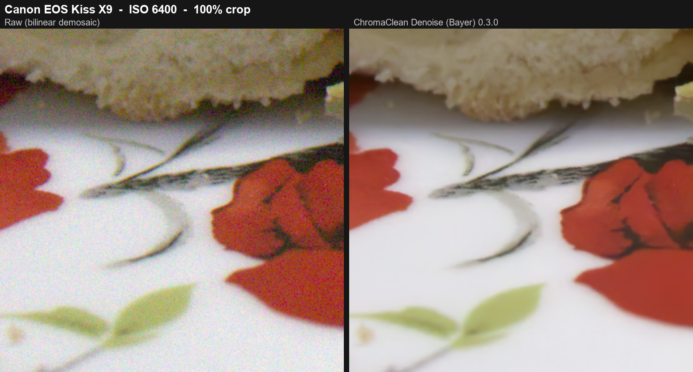
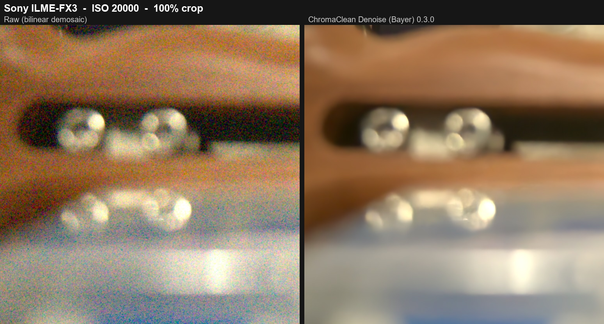
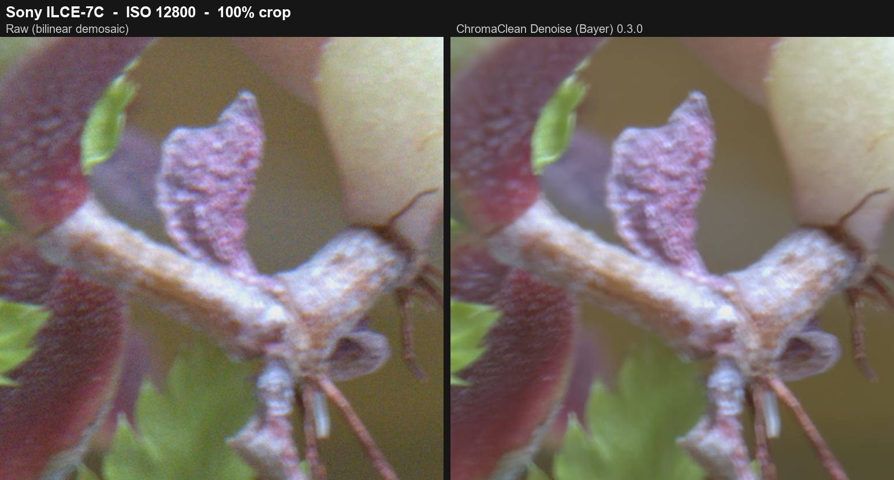
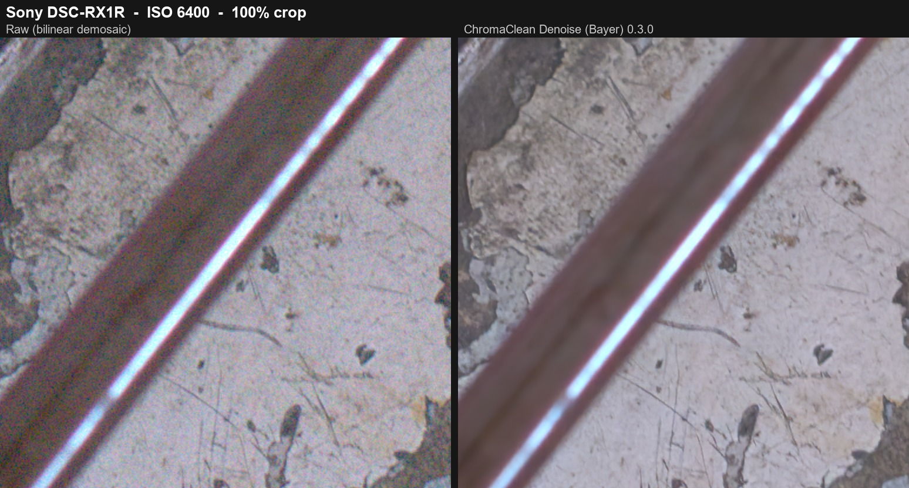
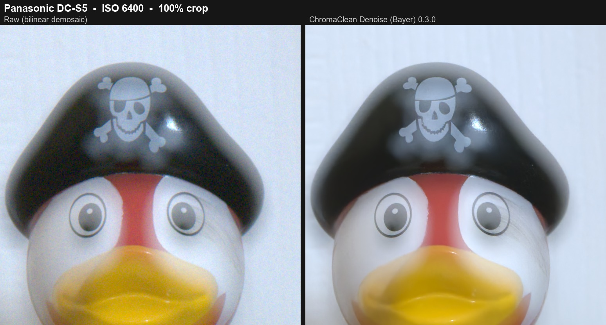
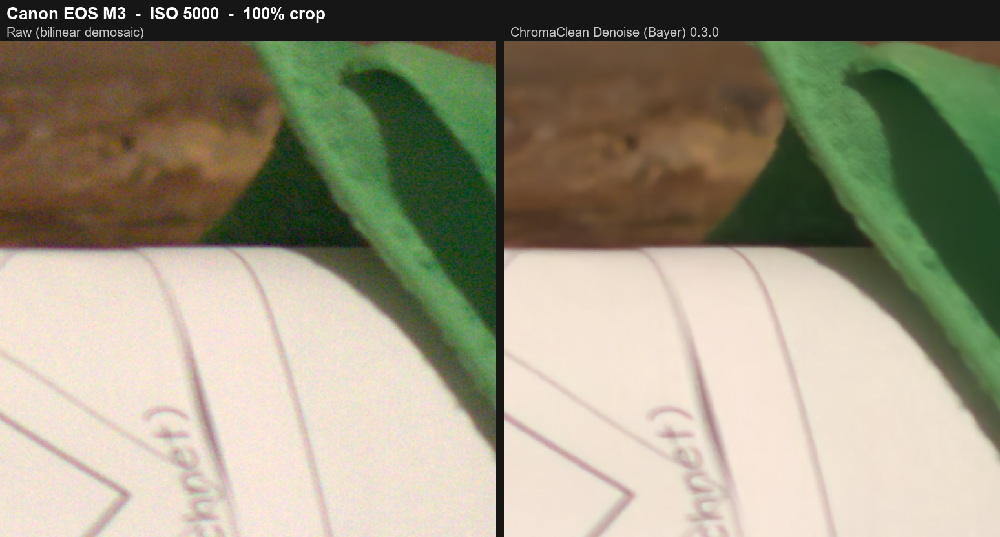
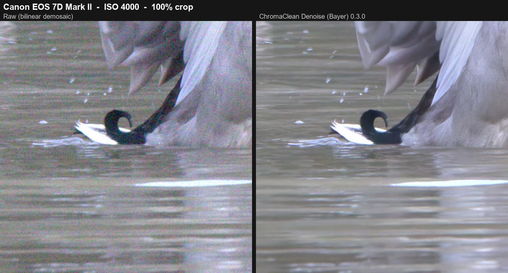
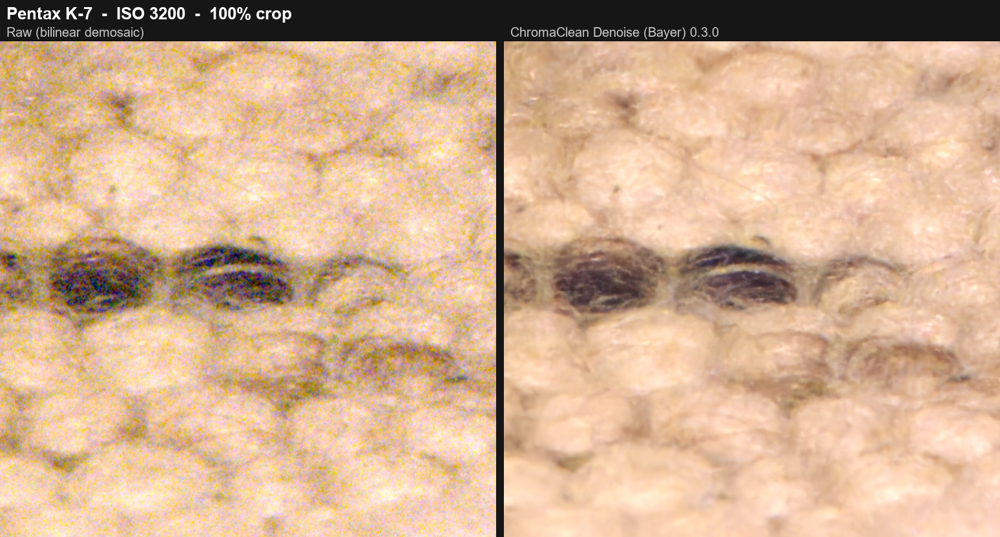
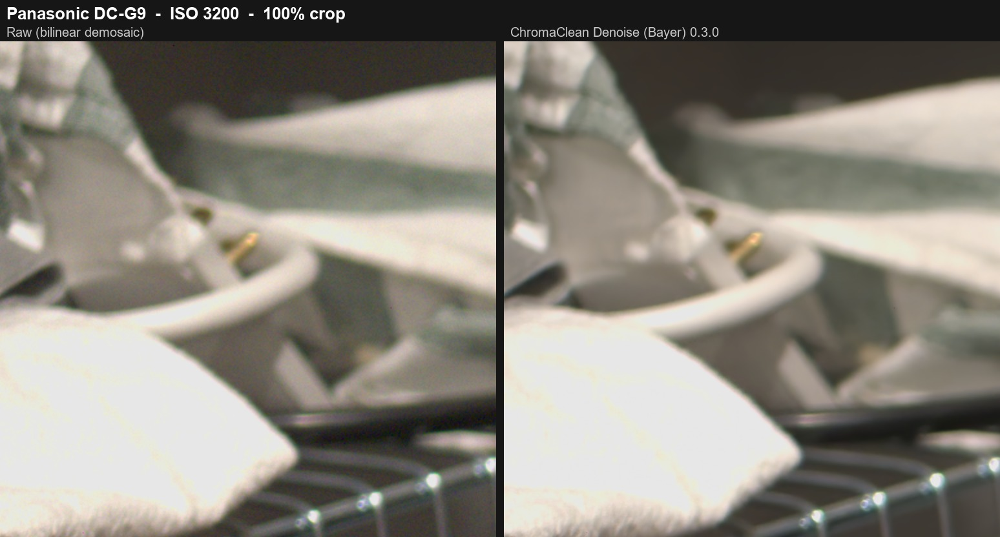

# ChromaClean Denoise

An AI raw denoiser for [Chromaforge](https://github.com/emmertex/chromaforge). It works on Bayer raw data before demosaicing and follows the app's `bayerToRgb` model contract, so the app installs it like any other AI Denoise model.

- **Model:** a 7.8-million-weight U-Net (31 MB ONNX). It is blind: it needs no noise-level input and handles ISO 100 to 25600+ on any Bayer camera.
- **Licence:** code and weights are MIT OR Apache-2.0, at your option. The training data is CC0, CC BY 4.0 (credited) and the author's own photos; see [NOTICE](NOTICE).
- **Version 0.3.0:** see [Releases](../../releases).



## Install

1. Download `chromaclean-bayer-0.3.0.zip` from the latest release and unzip it. It contains `model.onnx` and `denoise-model.json`.
2. In Chromaforge, open **Settings ▸ AI Denoise ▸ Install from file…** and choose `model.onnx`. Keep `denoise-model.json` in the same folder.
3. Accept the terms. The app runs its own self-test on your GPU, then lists **ChromaClean Denoise (Bayer)**.

## Examples

These are 100% crops from public-domain (CC0) raws on [raw.pixls.us](https://raw.pixls.us/), shot on cameras and at ISOs the model never saw in training. The left side is the raw with a plain bilinear demosaic. The right side is the output of the released `model.onnx`. Both sides get the same white balance, colour matrix and exposure. To rebuild them, run `training/make_examples.py`. The source files and checksums are in [examples/sources.json](examples/sources.json).

| | |
|---|---|
|  |  |
|  |  |
|  |  |
|  |  |

## How it compares

Tone-mapped PSNR in dB at ISO 25600, measured on real noisy frames from two cameras against an aligned base-ISO reference. These frames were never used in training. The full tables, from ISO 200 to 25600 on two tiles per camera, are in [results/](results/README.md).

| Camera, tile | Built-in | LightCraft | RawNIND | **ChromaClean 0.3.0** |
|---|---:|---:|---:|---:|
| Sony A7 IV, centre | 36.49 | 38.26 | 38.21 | **38.50** |
| Sony A7 IV, detail | 32.23 | 33.87 | 33.41 | **33.94** |
| Olympus E-M10 IV, centre | 31.84 | 34.93 | 33.57 | **35.13** |
| Olympus E-M10 IV, detail | 31.73 | **35.00** | 33.07 | 34.93 |

ChromaClean beats Chromaforge's built-in denoiser by 1–3 dB. It scores slightly above LightCraft in most cells, typically by 0.05–0.3 dB, which is a hard difference to see. Fine detail is the main gap left, and two test cameras are a small sample.

## How it was made

- **Clean pictures:** 25,267 low-ISO (≤ 400) crops of 256 × 256 Bayer cells. They come from 2,094 CC0 raws on raw.pixls.us (many cameras), 1,348 Cube++ raws (Canon 550D/600D, CC BY 4.0), and the author's own Sony A7 IV and Olympus E-M10 IV raws. A quality gate drops crops that are dark, clipped, still noisy or blurred. Noise is judged only on flat areas, so texture isn't mistaken for noise (`training/build_mixed.py`).
- **Target:** each clean crop is binned to one RGB value per 2 × 2 cell, then re-mosaicked. The target needs no demosaic, and binning halves its noise again.
- **Noise:** calibrated on real sensors with dark frames and flat fields (`training/calibrate.py`, `profiles/`). It models Poisson shot noise, Gaussian read noise, row banding, DN quantisation and white clipping. Training samples ranges wider than either camera, with white-balance and exposure jitter.
- **Training:** 200k steps with batch 16 and AdamW, cosine learning-rate schedule and an EMA of the weights. The loss is L1 on a log tone curve plus 0.25 × linear L1 (`training/train_cf.py`). It took about 70 minutes on an RTX 4070 SUPER.
- **Validation:** real ISO ladders shot on a tripod, aligned sub-pixel and brightness-matched (`training/real_pairs.py`).
- **Export:** Chromaforge's exportable network definition, ONNX with only the operators the app's runners support, then the app's own self-test (`training/export_cf.py`).

### Rebuilding or upgrading

Data lives outside the repository, in `$CHROMACLEAN_DATA` or by default the folder that holds this repository. The pipeline, in order:

```
python training/fetch_rpu.py --max-files 5000     # CC0 raws  -> rpu/
python training/cube_fetch.py                     # Cube++    -> cube/
python training/inventory.py <your raw folders>   # own raws  -> train/inventory.csv
python training/build_clean.py                    #           -> train/clean_crops.npy
python training/build_mixed.py                    # gate      -> train/clean_rgb.npy
python training/real_pairs.py scene_001           # validation pairs
python training/train_cf.py --data clean_rgb --steps 200000 --run cf3
python training/export_cf.py cf3 --version 0.3.0
python training/compare_cf.py <export dirs> scene_001
```

`fetch_rpu.py`, `cube_fetch.py` and `export_cf.py` use Chromaforge's `lc-denoise-rawdump` helper, built from a Chromaforge checkout into `train/rawdump-target`. `compare_cf.py` uses `tools/cf-bench` for the built-in denoiser.

## Credits

The network definition comes from Chromaforge (MIT). The data credits are the raw.pixls.us contributors (CC0) and the Cube++ dataset by Ershov et al., IEEE Access 2020 (CC BY 4.0). Details are in [NOTICE](NOTICE) and [credits/](credits/).
